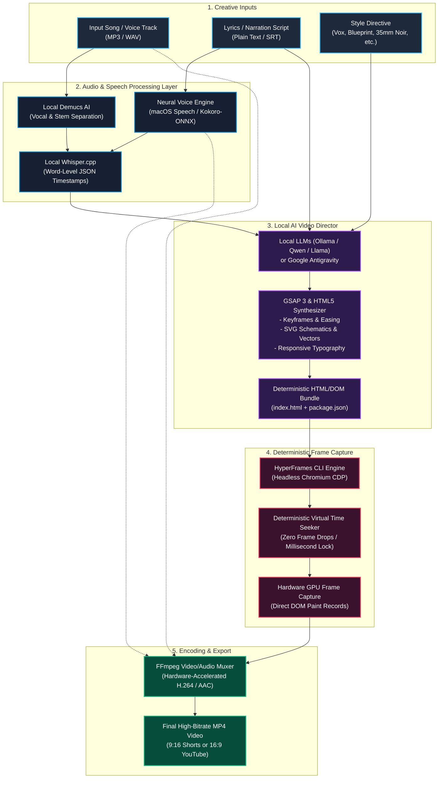
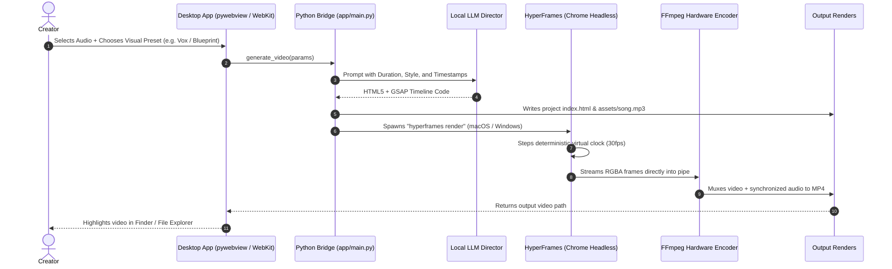

# 🎬 Antigravity Local Video Studio

[](https://opensource.org/licenses/MIT)
[]()
[]()
[]()
[]()

> **100% Free, 100% Local, Code-Driven AI Video Studio.**  
> Turn songs, voiceover scripts, and creative prompts into deterministic **9:16 Shorts/Reels** or **16:9 YouTube Explainers** using **Local AI Models (Ollama / Llama / Qwen / Antigravity)**.  
> **Zero Cloud Subscriptions • Zero API Costs • Zero Watermarks • Hardware Accelerated.**

---

## 📘 Comprehensive Free Guide Included

This repository comes with the official, full-length guide:  
👉 **[Download: Antigravity-Video-Free-Guide.pdf](./Antigravity-Video-Free-Guide.pdf)** 👈

---

## 🏗️ Graphified System Architecture

The studio replaces blurry, unpredictable diffusion video models with a **Deterministic Code-to-Video Engine**:



---

## 🔄 Component Interaction & Cross-Platform Bridge



---

## 🌟 Included Showcase Examples

This repository includes three complete, production-grade example videos created with the pipeline:

### 1. 🌿 "Aquascaping 10x ROI Side Hustle" (9:16 Vertical Tutorial)
* **File**: [`examples/aquascaping_plant_selling_10x_roi_tutorial.mp4`](./examples/aquascaping_plant_selling_10x_roi_tutorial.mp4)
* **Topic**: Turning Aquarium Plant Propagation into a 10x ROI Hobby Business (Rare Buce, Anubias, Tissue Culture & Floaters)
* **Format**: 1080×1920 (9:16 Vertical Shorts/Reels), 30 fps, 1 minute 19 seconds (79s)
* **Audio Track**: Clear guidance voiceover narration layered over an upbeat lo-fi chillhop / groove electronic bed.
* **Visual Style**: High-impact editorial social layout (matching Bloomberg Quicktake / NowThis style), red angled breaking badge, full-bleed photography Ken Burns drift, red pin locator dot with vertical leader lines, metric cards (`INVEST: $15`, `PROPAGATE: 10 CLONES`, `RETURN: 10X ROI`), and dynamic step counters.
* **Master Prompt**:
  ```text
  Create a 9:16 vertical video tutorial on making money with aquarium plants as a hobby.
  TOPIC: Buy rare Bucephalandra Blue and Anubias for $15-$25, propagate into 10 pieces, and sell for 10x ROI.
  DURATION: 79 seconds
  STYLE: Red pin indicator with leader line, breaking news top pill, full-bleed macro plant photography, lower-third headlines, and ROI metric badges.
  ```

### 2. ⚙️ "The Efficient Engineer" Show Video
* **File**: [`examples/efficient_engineer_refrigeration_and_heat_sink_cooling.mp4`](./examples/efficient_engineer_refrigeration_and_heat_sink_cooling.mp4)
* **Topic**: The Thermodynamics of Refrigeration & Semiconductor Chip Heat Sinks
* **Format**: 1920×1080 (16:9 Landscape YouTube), 30 fps, 35 seconds
* **Audio Track**: Los Del Rio – Macarena (Stereo sync)
* **Visual Style**: The Efficient Engineer signature slate blue (`#090e17`), engineering millimeter grid, thermodynamic closed loops with animated fluid particles (`stroke-dasharray`), heat flux arrows ($>150\text{ W/cm}^2$), and micro-cutaways of sintered copper heat pipe capillary wicks.
* **Master Prompt**:
  ```text
  Create a 16:9 widescreen educational explainer video in the exact aesthetic of 'The Efficient Engineer'.
  TOPIC: What is cooling really? Refrigeration cycle vs. Chip heat sinks.
  DURATION: 35 seconds
  AUDIO: assets/song.mp3 (Macarena audio track)
  STYLE: Deep slate blue (#090e17) background with technical millimeter grid. Precision vector schematics:
  - Scene 1: Clausius statement and the 2nd Law of Thermodynamics.
  - Scene 2: 4-stage vapor compression loop (Evaporator Q_in, Compressor W_in, Condenser Q_out, TXV).
  - Scene 3: Chip heat sink cutaway (Silicon die, TIM interface, sintered copper heat pipe with sonic vapor flow and capillary liquid return, and skived fin array q = h·A·ΔT).
  - Scene 4: Thermodynamic synthesis comparing active macro cycles vs passive micro phase change.
  Use GSAP 3 timeline synchronization and clean JetBrains Mono callout labels.
  ```

---

### 2. 📺 "Vox" Explainer Speaking Video
* **File**: [`examples/vox_k_shape_recovery_ai_geopolitics_explainer.mp4`](./examples/vox_k_shape_recovery_ai_geopolitics_explainer.mp4)
* **Topic**: The K-Shaped Recovery: AI Capital Monopoly, Displaced Cognitive Labor & Geopolitical Hegemony
* **Format**: 1920×1080 (16:9 Full HD), 30 fps, 1 minute 14 seconds (74s)
* **Audio Track**: Broadcast English voiceover narration layered over a synthesized minimalist tension documentary soundtrack (55Hz sub-bass, 105 BPM clockwork ticks, atmospheric pad).
* **Visual Style**: Iconic Vox editorial palette (charcoal black `#0f1013`, vibrant yellow `#ffe500`, warning red `#ff334b`), animated highlighter marker strokes, Fraunces serif headlines, animated K-divergence graphs, and global semiconductor chokepoint maps (ASML, TSMC, US Hyperscalers).
* **Master Prompt**:
  ```text
  Create a 16:9 Vox-style investigative explainer video.
  TOPIC: The K-Shaped Recovery: How Artificial Intelligence and Geopolitical Chokepoints are Splitting the World Order.
  DURATION: 74 seconds
  AUDIO: assets/song.mp3 (Full spoken voiceover with tension soundtrack)
  STYLE: Vox signature editorial design:
  - Scene 1 (0-18s): The Great Fracture: Animated bifurcation curve showing the upper K (+280% tech capital) and lower K (-34% real labor wages).
  - Scene 2 (18-37s): The AI Engine: Contrast between $14.2T compute monopolies and the 42% collapse in entry-level white-collar job postings.
  - Scene 3 (37-56s): Geopolitical Chokepoints: Interactive global schematic detailing ASML EUV lithography, TSMC 2nm/3nm fabrication, and the exclusion of the Global South into digital vassalage.
  - Scene 4 (56-74s): The Grave Reality: Three editorial warning tablets on Algorithmic Feudalism, Democratic Destabilization, and Public Compute Sovereignty.
  Include animated yellow highlighter pen draws and kinetic text cards synced to the narration.
  ```

---

## 🎨 Supported Visual Styles

| Style Category | Presets & Flavors | Description & Use Case |
| :--- | :--- | :--- |
| **Journalistic & Explainer** | Vox Editorial, The Efficient Engineer, Kurzgesagt, Johnny Harris, Veritasium | High-density data graphs, animated highlighter markers, isometric schematics, vector physics |
| **Social & Short-Form (9:16)** | Epic Duotone, Karaoke Fluid Highlighter, Kinetic Typography, Acid Y2K | Syllable-timed word pops, audio beat flashes, bold center text, TikTok/Reels/Shorts |
| **Cinematic & Artistic** | Vintage 35mm Noir, Ukiyo-e Woodblock, Impressionist Impasto, Synthwave 80s | Monochromatic 35mm grain, washi paper textures, neon outrun grids, painterly fades |
| **Hardware & Developer** | Cyberpunk CRT Terminal, 3D Blueprint Teardown, Apple Glassmorphism Keynote | Green phosphor scanlines, exploded wireframes, frosted glass blurs, CLI typing |

---

## 🚀 Quick Setup & Installation

### System Requirements
* **Operating System**: macOS (Apple Silicon or Intel) or Windows 10/11
* **Node.js**: v20+ (v24 recommended)
* **Python**: 3.11+ (Python 3.12 recommended)
* **FFmpeg**: Installed and accessible in PATH
* **Google Chrome**: Installed

---

### Setup on macOS (One-Click)

1. **Clone the repository**:
   ```bash
   git clone https://github.com/Bakulesh1Codes108/antigravity-video-studio.git
   cd antigravity-video-studio
   ```

2. **Run the automated setup**:
   ```bash
   chmod +x setup.sh run_studio.sh
   ./setup.sh
   ```

3. **Launch the Desktop Application**:
   ```bash
   ./run_studio.sh
   ```

---

### Setup on Windows (One-Click)

In Windows PowerShell (Run as Administrator or standard user):
```powershell
powershell -ExecutionPolicy Bypass -File .\setup.ps1
```
*(Or double-click `setup.bat`). This automatically configures FFmpeg, Whisper.cpp, Python virtual environment, and installs HyperFrames.*

---

## 🎮 How to Generate Videos

### Method 1: The Desktop UI
Run `./run_studio.sh` (macOS) or `setup.bat` (Windows) to open the native desktop studio:
1. Select your audio track (`.mp3`, `.wav`).
2. Paste your script or lyrics.
3. Choose your visual style preset (or write custom CSS instructions).
4. Select aspect ratio (**9:16 Vertical** or **16:9 Landscape**).
5. Click **Render Video with HyperFrames**!

### Method 2: Command-Line Local AI Director
```bash
python scripts/local_ai_director.py \
  --song "my_audio.mp3" \
  --lyrics "Your script or lyrics..." \
  --style "Vox Editorial Explainer with yellow highlighter and K-shape graph" \
  --duration 60 \
  --output "my-video-project"

cd my-video-project
hyperframes render
```

### Method 3: In Google Antigravity (Chat Interface)
Paste this master prompt into Antigravity:
```text
Make a 16:9 video explainer.
AUDIO: path/to/audio.mp3
SCRIPT:
[Paste your voiceover script or lyrics here]
STYLE: The Efficient Engineer style with deep slate blue background, animated fluid loops, and clean callout labels.
Synchronize visuals with HyperFrames and render the final MP4.
```

---

## 📂 Repository Structure

```
antigravity-video-studio/
├── Antigravity-Video-Free-Guide.pdf   # Complete official user guide (PDF)
├── app/
│   ├── main.py                       # Cross-platform desktop backend (macOS WebKit / Windows WebView2)
│   ├── ui.html                       # Modern high-contrast dark studio interface
│   ├── icon.png                      # App icon (PNG)
│   └── icon.ico                      # App icon (ICO)
├── examples/                         # Production showcase MP4 files
│   ├── efficient_engineer_refrigeration_and_heat_sink_cooling.mp4
│   └── vox_k_shape_recovery_ai_geopolitics_explainer.mp4
├── scripts/
│   ├── local_ai_director.py          # Bridge to local Ollama/Qwen/Llama models
│   ├── extract_vocals.py             # Demucs stem separator
│   └── transcribe_sync.py            # Whisper.cpp millisecond timestamp extractor
├── templates/
│   └── lyric-video/                  # Base 9:16 GSAP template
├── setup.sh                          # One-click installer for macOS
├── run_studio.sh                     # Native desktop launcher for macOS
├── setup.ps1                         # One-click PowerShell installer for Windows
├── setup.bat                         # Windows batch launcher
├── .gitignore                        # Prevents heavy caches & models (>100MB) from git
└── README.md                         # Graphified system documentation
```

---

## 📄 License
MIT License. Open-source, royalty-free for personal, educational, and commercial video creation.
